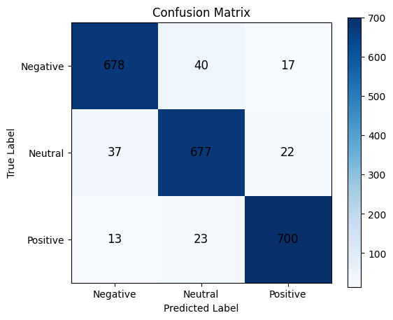

# Analisis Sentimen terhadap Kericuhan Demonstrasi RKUHAP DPR RI 2025 Menggunakan IndoBERT


Klasifikasi sentimen opini publik di media sosial **X (Twitter)** terkait kericuhan demonstrasi RKUHAP DPR RI 2025 ke dalam tiga kelas: **Negative**, **Neutral**, dan **Positive**, menggunakan model **IndoBERT** (`indobenchmark/indobert-base-p1`) yang di-*fine-tune*.

Project ini merupakan skripsi S1 Teknik Informatika, Universitas Pelita Bangsa (2026).

**Hasil utama:** Accuracy **0,94** dan Macro F1-score **0,94** pada 2.207 data uji yang seimbang.

---

## 📌 Latar Belakang

Pembahasan RKUHAP DPR RI tahun 2025 memicu aksi demonstrasi di berbagai daerah dan percakapan masif di media sosial X. Volume opini yang besar, tidak terstruktur, dan ditulis dalam bahasa informal (slang, singkatan, *code-switching*, sarkasme) membuat analisis manual tidak efisien. Project ini memanfaatkan NLP berbasis Transformer untuk mengklasifikasikan sentimen secara otomatis.

## 🎯 Tujuan

1. Membangun model klasifikasi sentimen berbasis IndoBERT untuk opini publik terkait demonstrasi RKUHAP DPR RI 2025.
2. Mengidentifikasi distribusi dan polaritas sentimen dominan masyarakat.
3. Mengevaluasi performa model dengan accuracy, precision, recall, dan F1-score.

---

## 🗂️ Dataset

| Keterangan | Detail |
|---|---|
| Sumber data | Dataset publik Kaggle: [sentimen-demo-dpr](https://www.kaggle.com/datasets/jawawahirul/sentimen-demo-dpr) |
| Platform asal | Media sosial X (Twitter) |
| Jumlah data awal | 18.837 teks |
| Atribut | `text`, `clean_text`, `normalize_text`, `sentiment`, `confidence_score` |
| Label | Negative, Neutral, Positive |
| Dataset final | 7.356 data (2.452 per kelas) |

**Distribusi label pada dataset awal (imbalanced):**

| Kelas | Jumlah | Persentase |
|---|---|---|
| Negative | 12.262 | 65,09% |
| Neutral | 4.660 | 24,74% |
| Positive | 1.915 | 10,17% |
| **Total** | **18.837** | **100%** |

---

## ⚙️ Metodologi

```
Dataset Kaggle → Text Cleaning → Normalisasi → Filter Confidence (≥ 0,85)
→ Augmentasi LLM → Gabung & Deduplikasi → Undersampling → Split 70:30
→ Fine-tuning IndoBERT → Evaluasi
```

### 1. Preprocessing
- **Text cleaning** (`text` → `clean_text`): hapus mention `@`, URL, emoji, simbol, dan spasi berlebih
- **Normalisasi** (`clean_text` → `normalize_text`): ubah kata tidak baku ke bentuk standar dan lowercase

| Sebelum | Sesudah |
|---|---|
| `@miradesianaa betul setuju bngt` | `betul setuju banget` |
| `Maaf maaf! Ga bisa balik lg itu nyawa anaknya!` | `maaf maaf! enggak bisa balik lagi itu nyawa anaknya!` |

### 2. Penanganan Ketidakseimbangan Kelas

| Tahap | File | Jumlah Data | Keterangan |
|---|---|---|---|
| Dataset awal | `data_labeled.csv` | 18.837 | Data mentah dari Kaggle |
| High confidence | `data_high_confidence.csv` | 13.793 | Filter `confidence_score >= 0,85` |
| Augmentasi LLM | `data_augmentasi.csv` | 1.559 | 11 Negative, 188 Neutral, 1.360 Positive |
| Gabungan | `data_combined.csv` | 15.352 | `concat()` + `drop_duplicates()` |
| **Final** | `data_balanced.csv` | **7.356** | Undersampling ke 2.452 per kelas |

> LLM hanya dipakai untuk membangkitkan data sintetis kelas minoritas. Model klasifikasi utamanya tetap IndoBERT.

### 3. Split Data
Stratified split 70:30 (`test_size=0.30`, `stratify=label`, `random_state=42`):

| Kelas | Train | Test |
|---|---|---|
| Negative | 1.717 | 735 |
| Neutral | 1.716 | 736 |
| Positive | 1.716 | 736 |
| **Total** | **5.149** | **2.207** |

### 4. Fine-tuning IndoBERT
Classification head (linear layer 768 → 3 kelas) di atas token `[CLS]`, dilatih end-to-end.

| Hyperparameter | Nilai |
|---|---|
| Pretrained model | `indobenchmark/indobert-base-p1` |
| Optimizer | AdamW |
| Learning rate | 2e-5 |
| Batch size | 16 |
| Epochs | 5 |
| Max sequence length | 128 |
| Dropout | 0.1 |
| Loss function | Cross-Entropy |

---

## 📊 Hasil

### Classification Report

| Kelas | Precision | Recall | F1-Score | Support |
|---|---|---|---|---|
| Negative | 0,96 | 0,92 | 0,94 | 735 |
| Neutral | 0,90 | 0,95 | 0,92 | 736 |
| Positive | 0,95 | 0,93 | 0,94 | 736 |
| **Accuracy** | | | **0,94** | 2.207 |
| **Macro Avg** | 0,94 | 0,94 | 0,94 | 2.207 |

### Confusion Matrix

| Aktual \ Prediksi | Negative | Neutral | Positive |
|---|---|---|---|
| **Negative** | **678** | 41 | 16 |
| **Neutral** | 15 | **699** | 22 |
| **Positive** | 12 | 37 | **687** |

<!-- Tambahkan gambar jika ada -->
<!--  -->

### Insight Utama
- Opini publik di X **didominasi sentimen negatif** (65% data awal), berisi kecaman terhadap tindakan aparat, keprihatinan atas korban, dan kritik terhadap proses legislasi RKUHAP.
- Sentimen netral umumnya berupa info, kronologi, atau pertanyaan singkat. Sentimen positif berisi apresiasi terhadap aksi mahasiswa dan harapan perubahan kebijakan.
- Kesalahan klasifikasi paling banyak terjadi di **batas kelas Neutral** (41 Negative dan 37 Positive salah diprediksi sebagai Neutral).

---

## 🔍 Error Analysis

Model masih lemah pada **sarkasme** dan **code-switching**:

| Teks | Aktual | Prediksi | Penyebab |
|---|---|---|---|
| `i hope you enjoy the hell you've built for you...` | Negative | Positive | Sarkasme + bahasa Inggris |
| `halahhh` | Negative | Positive | Slang ambigu, konteks implisit |

---

## 🧪 Eksperimen Tambahan: Pipeline Penerjemahan Otomatis

Untuk mengatasi teks non-Indonesia, dicoba pipeline *language-aware*: deteksi bahasa dengan `langdetect`, lalu teks non-Indonesia diterjemahkan dengan Google Translate API sebelum di-label ulang dan dilatih (partial undersampling 2:1:1, data uji tetap imbalanced).

| Metrik | Baseline | Pipeline Terjemahan |
|---|---|---|
| Accuracy | **0,94** | 0,88 |
| Macro Precision | **0,94** | 0,77 |
| Macro Recall | **0,94** | 0,84 |
| Macro F1-score | **0,94** | 0,79 |
| Data uji | 2.207 | 3.914 |

**Kesimpulan:** penerjemahan otomatis justru menurunkan performa, terutama di kelas Neutral (precision 0,56). Terjemahan cenderung mengubah nuansa teks media sosial yang pendek, informal, dan sarkastis. Pipeline baseline tetap dipakai sebagai hasil utama.

---

## 📁 Struktur Folder

```
├── data/
│   ├── data_labeled.csv
│   ├── data_high_confidence.csv
│   ├── data_augmentasi.csv
│   ├── data_combined.csv
│   └── data_balanced.csv
├── notebooks/
│   ├── baseline_indobert.ipynb
│   └── pipeline_translation.ipynb
├── images/
├── requirements.txt
└── README.md
```

---

## 🚀 Cara Menjalankan

```bash
git clone https://github.com/[username]/[nama-repo].git
cd [nama-repo]
pip install -r requirements.txt
```

Jalankan notebook di folder `notebooks/`. Disarankan pakai **Google Colab dengan GPU** untuk proses fine-tuning.

---

## 🛠️ Tech Stack

- **Bahasa:** Python
- **Data processing:** Pandas, NumPy
- **Modeling:** Hugging Face Transformers, Datasets, PyTorch
- **Evaluasi:** Scikit-learn
- **Visualisasi:** Matplotlib, Seaborn
- **Eksperimen:** langdetect, Google Translate API
- **Environment:** Google Colab, Google Drive

---

## 🔮 Pengembangan Selanjutnya

- Menambahkan modul deteksi sarkasme dan penanganan code-switching
- Mencoba model yang lebih besar atau multibahasa (IndoBERT-large, RoBERTa, DeBERTa)
- Memperluas data ke platform lain (Instagram, TikTok, Kaskus) dan topik berbeda

---

## 📄 Tentang Penelitian

Skripsi S1 Teknik Informatika, Universitas Pelita Bangsa, disahkan 26 Juli 2026.

- **Pembimbing:** Donny Maulana, S.Kom., M.M.S.I. & M. Zubair Abdurrohman, S.T., M.T.
- **Penguji:** Wiyanto, S.Kom., M.Kom. & M. Makmun Effendi, S.Kom., M.Kom.

---

## 👤 Author

**Muhammad Dikaisa Ibnu Amin**
Fresh graduate Teknik Informatika, tertarik di bidang Data Analyst & Data Science

- LinkedIn: linkedin.com/in/muhammaddikaisa/
- Email: muhammaddikaisa1@gmail.com
